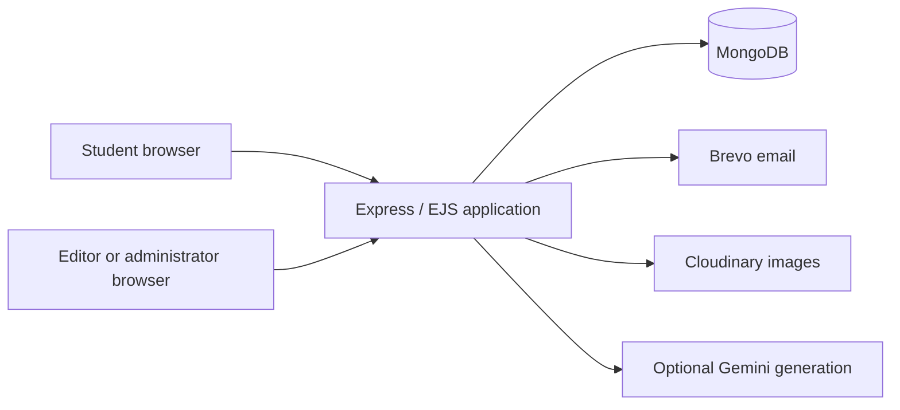
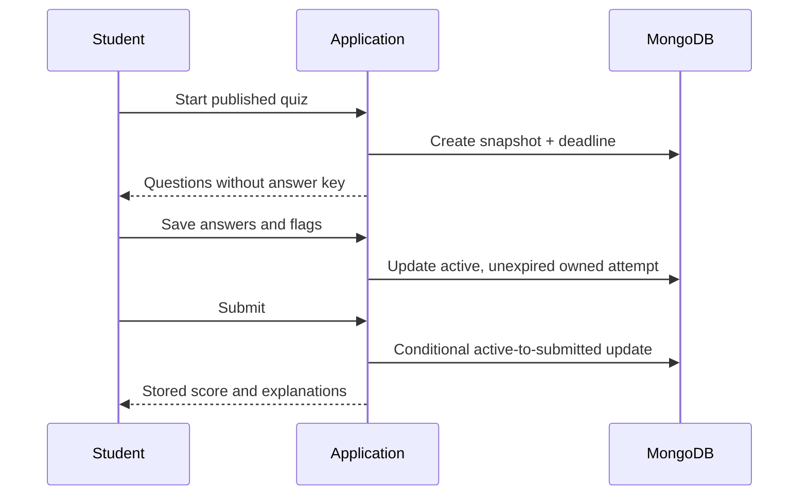
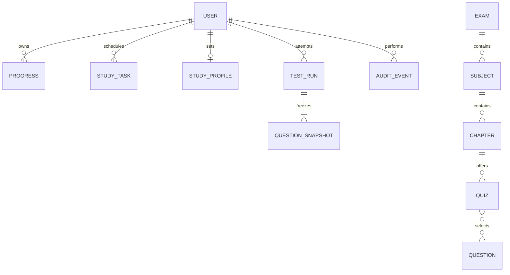

# Saarthi — Software Requirements Specification

Version 1.1 · 3 November 2026 · Implementation baseline and acceptance plan

## 1. Purpose and product vision

Saarthi supports a connected exam preparation journey: set a target, learn a chapter, plan practice, complete an assessment, understand mistakes and revise weak topics. It serves students preparing for structured academic examinations and instructors maintaining reusable learning content.

The intended outcome is a demonstrable, deployable educational application with understandable recommendations, consistent assessment records, and traceable publishing decisions. Analytics describe activity recorded in Saarthi; they do not claim to predict an external exam score.

## 2. Scope and boundaries

The baseline includes account verification, authentication, exam/subject/chapter content, personal notes and bookmarks, learning completion, study goals, dated tasks, milestone badges, timed tests, answer autosave, results, mistake review, revision sessions, CSV question imports, draft/review/publication, publishing-settings revision history and audit events.

Optional external capabilities include transactional email, hosted question images and AI-generated question drafts. Paid subscriptions, proctoring, official exam integrations and certified learning outcomes are outside this release.

The demo fixtures are illustrative content and accounts; actual user statistics derive from stored records. The fixture video is explicitly labeled as illustrative.

## 3. Stakeholders and actors

| Actor | Responsibilities and permissions |
|---|---|
| Visitor | Browse public information; register and request account recovery |
| Student | Maintain own progress, notes, goals and tasks; attempt published quizzes; inspect own results |
| Content editor | Maintain content/questions, import questions, create and review quiz drafts |
| Administrator | All editor permissions; approve publication and manage administrator roles |
| External providers | Deliver emails, store images or generate candidate question content |

An editor is represented by the user `editor` flag; administrators retain the existing `admin` flag. Administrators can assign or remove editor permissions through the publishing desk. The existing admin dashboard supports administrator-role changes.

## 4. System context and architecture

The application renders server-side EJS pages and uses a small client-side script for interactive test navigation and autosave. MongoDB stores domain records. Production flash sessions use a persistent MongoDB session store. Authentication uses short-lived access tokens backed by revocable database sessions and rotating refresh tokens.

## 5. Functional requirements and acceptance criteria

| ID | Requirement | Acceptance criteria |
|---|---|---|
| AUTH-01 | Register and verify an account | A purpose-specific, unexpired email code is required to verify; a consumed code cannot be reused |
| AUTH-02 | Authenticate and revoke sessions | Verified credentials establish cookies; logout clears cookies; revoked sessions cannot authenticate |
| AUTH-03 | Recover a password | Reset codes are separate from verification codes; successful reset revokes existing sessions |
| DASH-01 | Show personalized overview | Counts reflect the current account's recorded activity; an empty account has explanatory states |
| DASH-02 | Set a preparation target | Student can save exam name, valid target date and weekly chapter goal between 1 and 50 |
| LEARN-01 | Discover chapters | Keyword search matches chapter titles/descriptions; result cards identify subject and exam |
| LEARN-02 | Use a chapter workspace | Published chapter resources and quizzes are available alongside personal study controls |
| LEARN-03 | Persist personal study state | Notes, completion and bookmark state survive reload; another account cannot alter them |
| PLAN-01 | Schedule study tasks | A nonempty title and real calendar date are required |
| PLAN-02 | Update a study session | Owner can change date and completion; a non-owner receives a not-found response |
| ENGAGE-01 | Award activity milestones | Badges appear only when their documented completion or participation threshold is met |
| TEST-01 | Start a published assessment | Draft/reviewed tests cannot be started by students; active published tests create a private attempt |
| TEST-02 | Freeze assessment content | Attempt holds a question/options/solution snapshot and scoring settings independent of future edits |
| TEST-03 | Navigate and flag questions | Student can navigate numbered questions, choose/clear an answer and mark for review |
| TEST-04 | Save and recover answers | Valid choices and flags persist on save; refresh restores the saved state; save failures are visible |
| TEST-05 | Enforce a deadline | Server rejects writes after expiry; reopening an expired attempt finalizes it; the open player submits on countdown expiry |
| TEST-06 | Grade deterministically | Correct marks, incorrect penalties and skipped counts use the stored scoring settings; foreign option IDs are rejected |
| TEST-07 | Submit safely | Submitted state is immutable through answer-save endpoints; repeated submit returns the stored result |
| RESULT-01 | Review an owned result | Correct/wrong/skipped totals and explanations render only for the owner of the new timed attempt |
| INSIGHT-01 | Show performance history | Completed timed tests produce an accuracy trend and linked result history |
| INSIGHT-02 | Maintain a mistake notebook | Incorrect/skipped questions appear with solutions and links to matching chapter resources |
| REVISE-01 | Create targeted practice | Recent missed questions are deduplicated into a private revision attempt of at most ten questions |
| ADMIN-01 | Maintain educational content | Authorized content staff can create and edit exams, subjects, chapters, materials and questions |
| ADMIN-02 | Build valid quizzes | Creation checks the chapter and question references and saves new quizzes as drafts |
| ADMIN-03 | Review and publish | Publishing requires administrator permission and a reviewed state; published quizzes become student-visible |
| ADMIN-04 | Record settings changes | Publishing mutations retain previous settings and write an actor/action audit event |
| IMPORT-01 | Validate CSV questions | CSV format, answer letter and required options are validated; up to 100 rows are previewed before confirmation |
| AI-01 | Assist question drafting | Existing AI generation is optional and produces editable candidate content; staff review before publication |

## 6. Principal use cases

### UC-01: Learn and record progress

Precondition: authenticated student; chapter exists. Student searches the library, opens a chapter, studies resources, edits notes and saves completion/bookmark state. System validates the chapter and note limit, saves state under that student's ID, and confirms success. Missing content returns not found; validation errors leave stored progress unchanged.

### UC-02: Complete a timed assessment

Precondition: authenticated student; published quiz contains questions. System creates/reuses an active attempt and fixes its deadline and snapshot. Student answers and flags questions; the client saves to owner-scoped endpoints. Student confirms submission; server freezes and grades saved answers. At expiry, further writes fail. A missed save is explicitly reported; unsaved choices are not silently treated as persisted.

### UC-03: Publish an assessment

Content staff create a draft and preview questions. They record the reviewed state. Administrator confirms publication with duration and scoring settings. System checks required state, records previous settings and an audit event, and exposes the quiz in the student catalog. Invalid transitions and non-administrator publication fail without changing status.

### UC-04: Import a question batch

Content staff select a chapter and load CSV text/file. System parses and validates every row and displays valid count/errors with sample questions. Staff explicitly confirm the validated payload. System revalidates on the server and inserts the batch, then logs an import event. A malformed row prevents the confirmation path from importing that batch.

## 7. Data model and constraints

| Entity | Essential data and rules |
|---|---|
| Progress | Unique user/chapter pair; completion, bookmark, notes ≤10,000 characters |
| StudyTask | Owner, title ≤160 characters, ISO calendar date, completion |
| StudyProfile | One per user; exam label, target date, weekly goal 1–50 |
| Quiz | Chapter and question references; draft/reviewed/published; duration 1–240 minutes; scoring settings; settings versions |
| TestRun | Owner, source quiz, content snapshot, saved answers/flags, deadline, status, stored result |
| AuditEvent | Actor, action, target/details, creation timestamp |
| OTP | User/email, hashed code, purpose, ten-minute lifetime and one-use consumption |

Questions used in quizzes cannot be deleted through the existing delete endpoint. Historical timed results use snapshots. Legacy quiz attempts remain readable through their existing owner-scoped result route.

## 8. Nonfunctional requirements

| ID | Target and verification method |
|---|---|
| SEC-01 | Every private study/test query is owner-scoped; verify through cross-account integration tests |
| SEC-02 | Mutating browser requests validate same origin or a session-bound form token; production cookies use HTTPS, HttpOnly and SameSite |
| SEC-03 | Passwords are hashed; OTPs use cryptographic randomness; secrets are environment-managed |
| REL-01 | Answer saves and submission cannot mutate an already submitted run; verify repeated and expired requests |
| REL-02 | Progress, tasks and production sessions survive app restart; deployment acceptance test required |
| UX-01 | Main studio screens adapt to desktop and narrow layouts; keyboard/contrast/browser QA required |
| PERF-01 | Target p95 server response under 1 second for normal reads with 50 concurrent students and seeded moderate data; load testing pending |
| PERF-02 | Target p95 answer-save response under 1 second on a healthy connection; measurement pending |
| OPS-01 | Application starts only after database connection; health endpoint exposes HTTP liveness |
| OPS-02 | Backups and restore drills must be configured before public production release |

Performance and accessibility targets are acceptance goals, not claims of measured compliance.

## 9. Verification traceability

| Requirement group | Evidence location |
|---|---|
| Authentication/origin/legacy privacy | tests/security.test.js |
| Dashboard metrics/date validation | tests/study.test.js |
| Scoring/answer sanitation/answer-key secrecy | tests/testEngine.test.js |
| Learning, tasks, ownership, autosave, expiry, revision | tests/integration/workflows.test.js |
| Publishing, draft exclusion, CSV preview | tests/integration/workflows.test.js |
| JavaScript/EJS syntax | npm run check |
| Appearance/mobile/browser interaction | Manual presentation rehearsal; capture evidence before release |
| Optional providers and hosting | Deployment acceptance checklist in DEPLOYMENT.md |

## 10. Release risks and next increments

Future increments include advanced full-text resource search, full question/content version restore, shared per-account OTP throttling, provider monitoring and CSP hardening. Basic resource-title search and kind filtering are implemented. These are not represented as completed baseline features. Per-question timing is an approximate client-reported active-time measure, not proctoring evidence. The weekly agenda uses the validated browser timezone, falling back to UTC. Current performance history focuses on the new timed-test engine; the dashboard also counts legacy attempts.

The test player submits when open at expiry. Expired attempts finalize on access/save; a server worker also finalizes abandoned attempts in batches every 30 seconds while the application is running. Simultaneous starts reuse an active attempt through a unique sparse activeKey index, initialized before the production/demo HTTP listener opens. Submission and expiry release the key. Publishing and its audit write are separate writes; transactional audit guarantees require a replica-set deployment.

An earlier dependency audit reported moderate findings. The current advisory registry was unreachable; no current count is asserted. External integrations and container hosting require separate deployment evidence. The default Content Security Policy remains disabled for compatibility with existing scripts; tighten it before public production use.

See DEMO.md for the presentation sequence and DEPLOYMENT.md for environment and release steps.

## Material-management extension

ADMIN-05: Authorized content staff can select a chapter, create/edit a video, document or website resource, upload/replace/detach a PDF, and publish or hide the material. Existing lecture/note/sheet visibility is managed in the same surface. Invalid schemes, unsupported uploads and invalid chapter references are rejected.

LEARN-04: Student chapter pages render published resources from MongoDB, including embedded supported videos, external fallback links, PDF reading and descriptions. PDF access is authenticated and checks visibility.

CONTENT-01: Administrators can edit the site name in SiteSettings. Functional interface titles and instructions remain application labels; promotional headlines and motivational taglines are not rendered. Previously stored promotional fields are retained for compatibility but are not exposed in the editor.

UI-OBS-01: The shared interface uses a near-black observatory scene, blue overhead illumination, prominent planet and stars, and orange task actions without spark effects. Interface copy contains functional titles, feature descriptions and necessary instructions without promotional taglines or emojis.

UI-OBS-02: Script-free internal workspace navigation preserves the scene and interpolates toward the next URL’s deliberate view over 1.2 seconds; complex editors, lessons and test runs retain native navigation with camera continuity where available. Reduced-motion mode displays a static scene. Unsupported WebGL uses a static planet fallback. Visual effects must not intercept normal navigation or form submission.

CONTENT-02: Successful admin mutations increment the content revision. Open student pages check for updates every five seconds while visible. Student work and in-progress assessments are protected from automatic full-page reloads. No source change or rebuild is required for publication.

Storage: LearningResource references chapter, type, title, description, optional URL or GridFS file ID, visibility and creator/editor timestamps. PDF binary chunks and metadata remain in MongoDB, not a local upload directory. SiteSettings stores the editable site name and content revision.

Visual baseline: the current world is the dark blue/orange observatory in DESIGN.md; the earlier light/purple adaptation is superseded. Star navigation represents actual saved chapter progress. Motion respects reduced-motion preference and page visibility. There are no emoji-based interface icons.

## Verified reliability and workflow extension

| ID | Requirement | Acceptance evidence |
|---|---|---|
| UI-OBS-03 | Shared dark shell, functional copy and readable surfaces for all admin editors; no quote-management workflow | Admin/editor HTTP checks and desktop/mobile/tablet captures |
| UI-OBS-04 | Stable seeded star field plus static SVG layer; scene remains visible with reduced motion and after resize | Browser motion toggle and final captures; OS preference implementation inspected |
| UI-OBS-05 | Planet remains behind task content; no fireworks; consistent seven-day agenda at all widths | Independent reviewer scored planner correction resolved |
| MAT-ORDER | Staff assigns integer position 0–9999; stable ordering within videos/documents | DB-backed order assertions |
| MAT-PREVIEW | Staff preview includes hidden materials and excludes archived ones; students cannot use preview to bypass visibility | Role-specific DB checks |
| MAT-ARCHIVE | Staff can archive and restore legacy/new materials without destructive deletion; previous publication state retained | DB and browser archive/restore |
| MAT-SEARCH | Library supports literal resource-title search and video/document/link filters | DB and browser checks |
| SAVE-STATE | Forms expose unsaved/saving/success/error feedback; internal navigation protects dirty forms | Browser exercises and source review; full offline emulation unverified |
| PLAN-EDIT | Edit title/date/completion, reject impossible dates, use validated browser timezone | DB checks across three timezones and browser Asia/Calcutta |
| TEST-IDEMPOTENCY | Concurrent starts share one attempt; repeated submission is safe; expired/stale attempts resolve to results | Six concurrent starts, repeated submit, expiry checks and browser walkthrough |
| AUTH-RECOVERY | Purpose/expiry-bound OTP consumption, password reset and session revocation | Isolated real-DB OTP fixtures; email delivery unverified |
| OPS-RESTART | Production auth/session and notes persist across app restart | Two production-mode processes using one temporary database |

LearningResource and legacy resource records now include position (default 0) and archived (default false). Archived records are retained. Student visibility requires published and not archived; staff may review records and documents. Resource order is applied independently to video and document groups.

The browser timezone is a non-sensitive preference cookie, validated through Intl before use; invalid or absent values use UTC. Planner day boundaries use this timezone. Activity streaks remain explicitly based on UTC days. Dashboard totals retain earlier and timed attempts; the performance view identifies the timed-analysis scope and links earlier results separately.

The exact executed workflow matrix, fixture handling, capture dimensions and unresolved environment checks are in WORKFLOW-AUDIT.md. This local verification is not certification of live email, external playback, image/AI providers, public TLS, hosting, Docker, load capacity or backup restoration.
